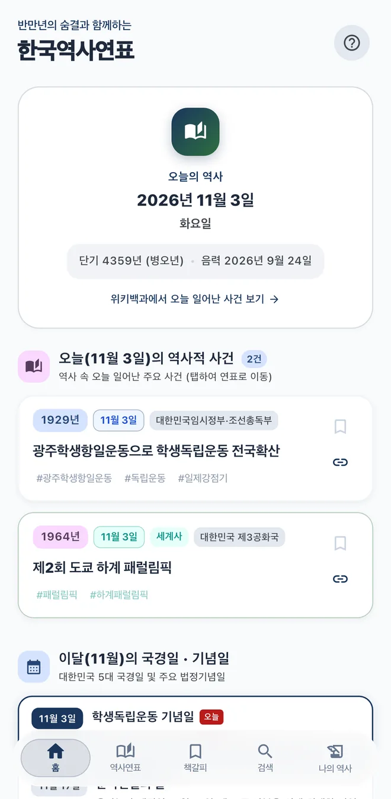
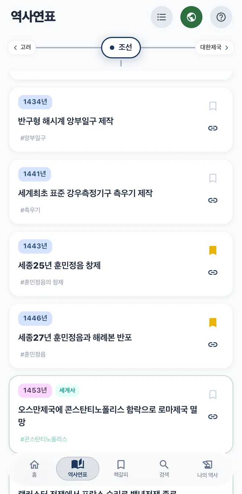
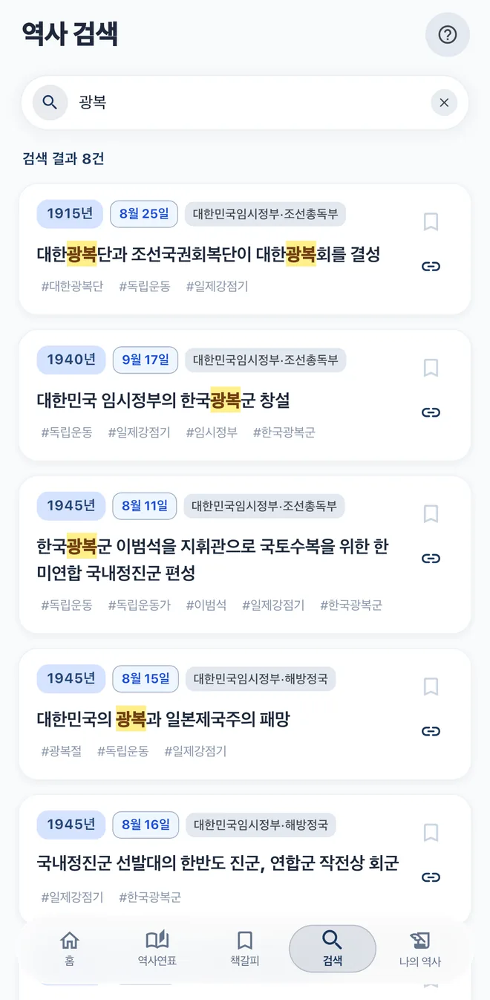
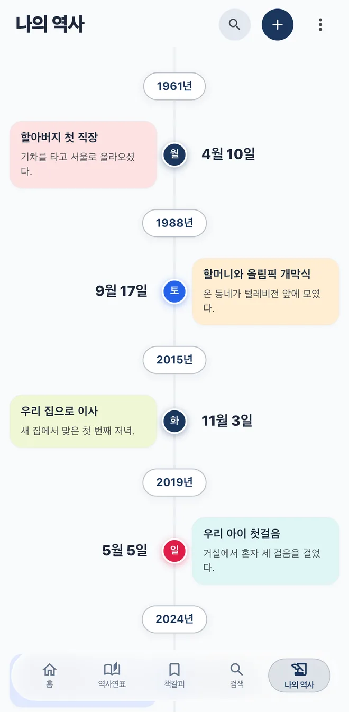

  

<h1 align="center">한국역사연표 Korea History Timeline</h1>

A mobile app that lays out Korean and world history side by side on one timeline

<a href="README.md">한국어</a> | <strong>English</strong>

  <a href="https://apps.apple.com/kr/app/%ED%95%9C%EA%B5%AD%EC%97%AD%EC%82%AC%EC%97%B0%ED%91%9C/id6749217619"><strong>App Store</strong></a>
  &nbsp;·&nbsp;
  <a href="https://play.google.com/store/apps/details?id=com.mcnorton.korea_history"><strong>Google Play</strong></a>
  &nbsp;·&nbsp;
  <a href="https://koreahistory.mcnorton.com"><strong>Website (Korean)</strong></a>

  
  
  
  

> The app and its website are available in Korean only.

## About

See what happened in Korea and in the rest of the world in the same year, on a single screen. The app covers 827 events (464 Korean, 363 world) across 31 eras, and major events are recorded down to the date, not just the year. Figures are as of version 1.2.4.

Students can use it to study, teachers can use it in class, and families can add their own events and view them as a personal timeline.

## Features

| Tab | What you can do |
| --- | --- |
| **Home** | See today's date in the solar, Dangun, sexagenary, and lunar calendars, along with historical events from this date, this month's national holidays, and your own entries from the same day in past years. Theme and text size settings are here too. |
| **Timeline** | Swipe between eras or pick one from the list. Tap the globe button to show world history alongside Korean history, and follow an event's link to read more on Wikipedia and other sites. In landscape on a tablet, two neighboring eras appear side by side. |
| **Bookmarks** | Collect the events you've bookmarked. Tap one to jump to it on the timeline. |
| **Search** | Find events by name, person, year, or tag. Results appear as you type, and recent searches are one tap away. |
| **My History** | Record events from your own life or family with dates and view them as a timeline. Back up to a file and restore at any time. |

The [user guide](https://koreahistory.mcnorton.com/wiki/) and [use cases](https://koreahistory.mcnorton.com/cases/) have more detail, in Korean.

## Install

- **iPhone, iPad:** [App Store](https://apps.apple.com/kr/app/%ED%95%9C%EA%B5%AD%EC%97%AD%EC%82%AC%EC%97%B0%ED%91%9C/id6749217619)
- **Android:** [Google Play](https://play.google.com/store/apps/details?id=com.mcnorton.korea_history)

You can also search the stores for "한국역사연표".

## Links

- [Website](https://koreahistory.mcnorton.com)
- [Version history](https://koreahistory.mcnorton.com/history/)
- [Privacy policy](https://koreahistory.mcnorton.com/privacy/)
- [Send feedback](https://koreahistory.mcnorton.com/helpdesk/): report mistakes, suggest events, or share how you use the app.

## This repository

| Branch | Contents |
| --- | --- |
| [`site`](https://github.com/mcnorton/koreahistory/tree/site) | The live website |
| `main` | This README and the archived previous site (`wiki.md`, `history.md`, `privacy.md`, `helpdesk.md`) |

The app's source code is not in this repository.

---

2018-2026, McNorton&Education
