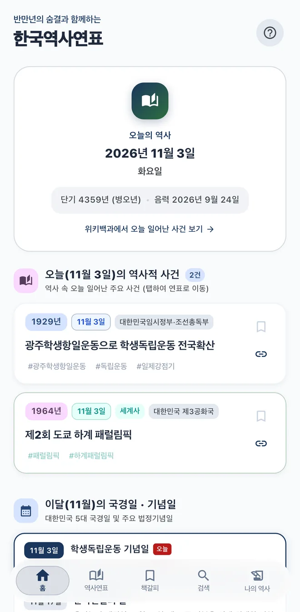
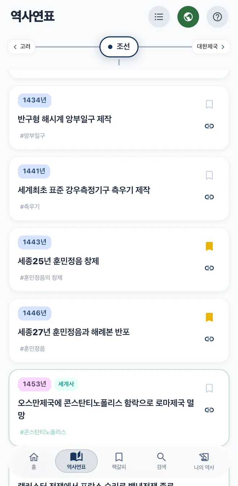
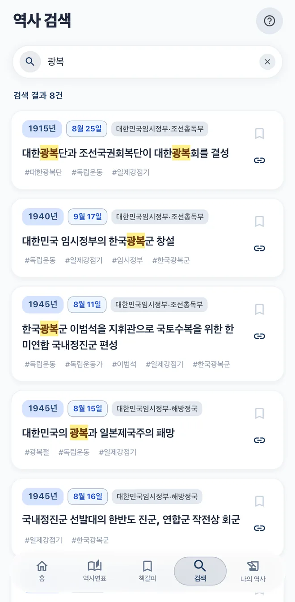
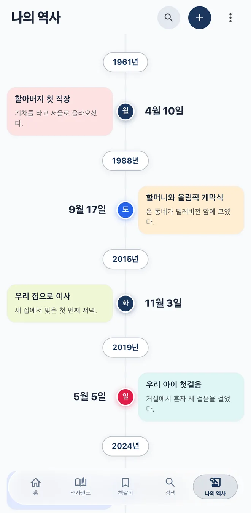

  

<h1 align="center">한국역사연표</h1>

한국사와 세계사를 한 줄의 연표로 나란히 보는 모바일 앱

<a href="README.md">English</a> | <strong>한국어</strong>

<h3 align="center"><a href="https://koreahistory.mcnorton.com">공식 웹사이트 바로가기: koreahistory.mcnorton.com</a></h3>

  <a href="https://apps.apple.com/kr/app/%ED%95%9C%EA%B5%AD%EC%97%AD%EC%82%AC%EC%97%B0%ED%91%9C/id6749217619"><strong>App Store에서 받기</strong></a>
  &nbsp;·&nbsp;
  <a href="https://play.google.com/store/apps/details?id=com.mcnorton.korea_history"><strong>Google Play에서 받기</strong></a>

  
  
  
  

## 어떤 앱인가요

같은 해에 한국과 세계에서 무슨 일이 있었는지 한 화면에서 비교할 수 있습니다. 31개 시대에 사건 827건(한국사 464건, 세계사 363건)을 담았고, 중요한 사건은 연도뿐 아니라 날짜까지 기록했습니다.

학생의 역사 공부와 교실 수업에 쓸 수 있고, 가족의 일을 나의 역사로 남겨 연표로 볼 수도 있습니다.

## 주요 기능

| 탭 | 할 수 있는 일 |
| --- | --- |
| **홈** | 오늘의 양력, 단기, 간지, 음력을 보고, 오늘 날짜의 역사적 사건과 이달의 국경일, 과거 같은 날의 내 기록을 확인합니다. |
| **역사연표** | 좌우로 넘기거나 목록에서 시대를 고릅니다. 지구본 버튼으로 세계사를 함께 봅니다. |
| **책갈피** | 책갈피를 표시한 사건을 모아 보고, 연표의 그 위치로 이동합니다. |
| **검색** | 사건, 인물, 연도, 태그로 찾습니다. 입력하는 동안 결과가 나옵니다. |
| **나의 역사** | 나와 가족의 일을 기록해 연표로 봅니다. |

**사용설명서와 수업 활용 아이디어는 [공식 웹사이트](https://koreahistory.mcnorton.com)에서 볼 수 있습니다.**

## 버전 이력

### 정식출시

#### 1.2.4 (2026년 10월 13일)
- 대한민국 일제강점기 독립운동사 추가
- 태그 검색기능 강화와 주요 역사적 사건의 태그 작업
- 지질연대의 큰 숫자 연도를 읽기 좋게 개선
- 시대분류와 사건의 일부를 보기 쉽게 정리
- 하계/동계 올림픽과 하계/동계 패럴림픽 역대 개최 정보를 세계사에 추가
- 일부 디바이스에서 어긋나 보이는 인터페이스 오류 개선

#### 1.2.3 (2026년 10월 1일)
- 역사연표의 시대별 사건을 새롭게 배치해 입체적으로 탐색
- 머티리얼과 리퀴드글래스 스타일로 인터페이스 구성
- 태블릿 가로보기에서 역사연표를 펼쳐 보기 쉽게 개선

#### 1.1.5 (2025년 9월 15일)
- 역사 데이터 오류 수정
- 불분명한 설명을 명료하게 정리
- 도움말의 사용설명서에 수업 활용 아이디어 제안

#### 1.1.4 (2025년 8월 26일)
- 검색 히스토리 기능 추가
- 나의 역사 타임라인을 나무 형태로 보기 좋게 개선
- 메뉴 선택 디자인 개선
- 사용자 의견 페이지 개선
- 역사연표 가독성 개선
- 도움말 간소화
- 내부 코드 최적화와 버그 개선

#### 1.0.17 (2025년 8월 19일)
- 나의 역사 목록에 요일 추가
- 단기 옆에 갑자 연도 추가
- 여성 항일 독립운동사 추가
- 스마트폰 비율에 따른 화면 깨짐 개선
- 인터페이스 개선
- 날짜 계산 오류 수정
- 과학사와 인물사 추가 시작

#### 1.0.16 (2025년 8월 14일)
- 음력 계산 오류 해결
- 광복 80주년 기념 독립운동사 자료 추가
- 한국사/세계사 분류 오류 수정
- 두산백과를 참고해 자료 보완

#### 1.0.15
- 애플 앱스토어 출시
- 방해가 될만한 광고 차단

#### 1.0.14
- 근현대사 풍부화
- 역사키워드 완성

#### 1.0.13
- 검색 기능 보완
- 앱아이콘 변경
- 파스텔컬러로 분류
- 통일왕조시대 풍부화

#### 1.0.12
- 태블릿의 넓은 화면 관련 개선
- 구글 플레이스토어 출시

#### 1.0.11
- 검색기능을 메뉴로 분리
- 나의 역사연표 기능 추가

### Beta

#### 1.0.9
- 플레이스토어 내부테스트
- 역사데이터 분류작업

### Alpha

#### 0.0.10
- 데이터 3종 수집하고 통합
- 중복데이터 제거
- 리스트 전체를 접고/펴는 기능 난제

#### 0.0.9
- Flutter/dart 개발 시작
- 대량의 리스트 손실 문제 해결

---

2018-2026, McNorton&Education
