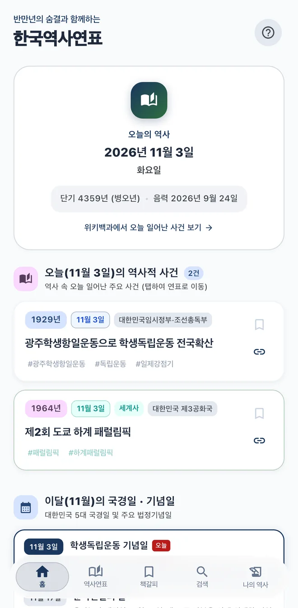
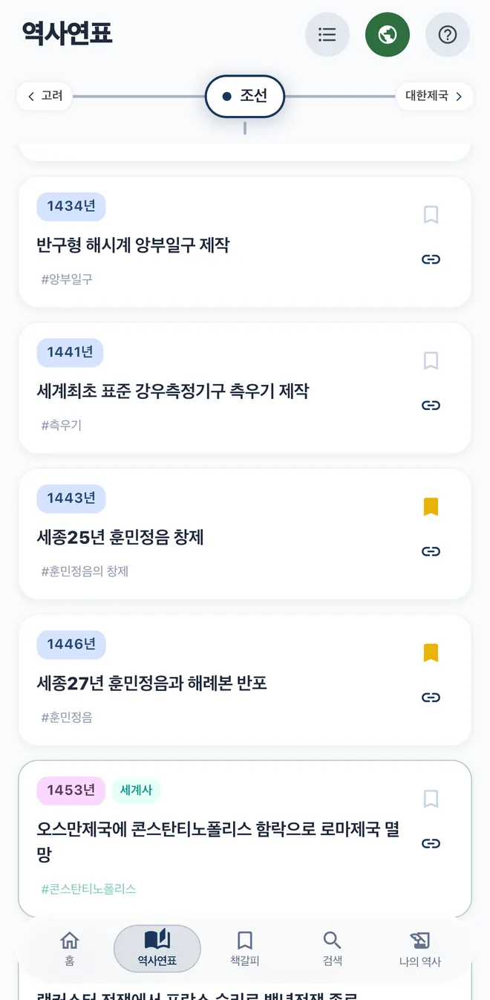
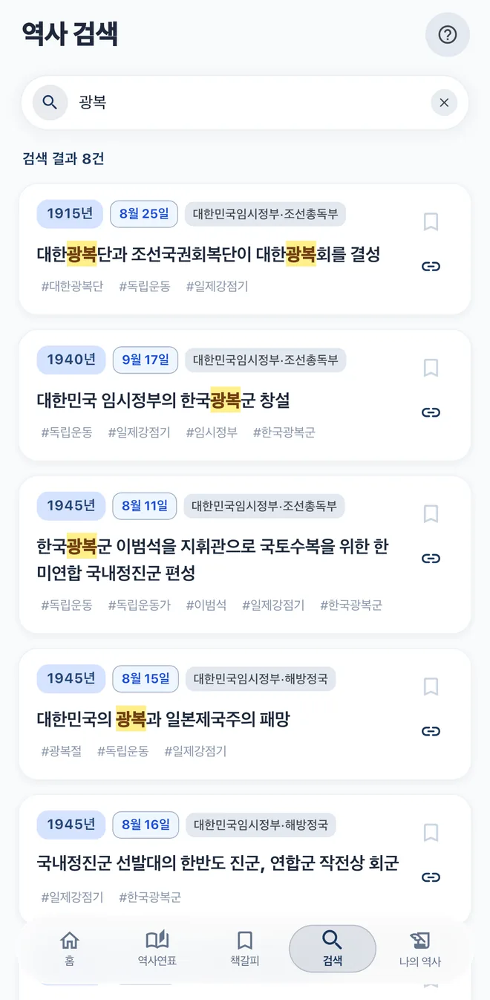
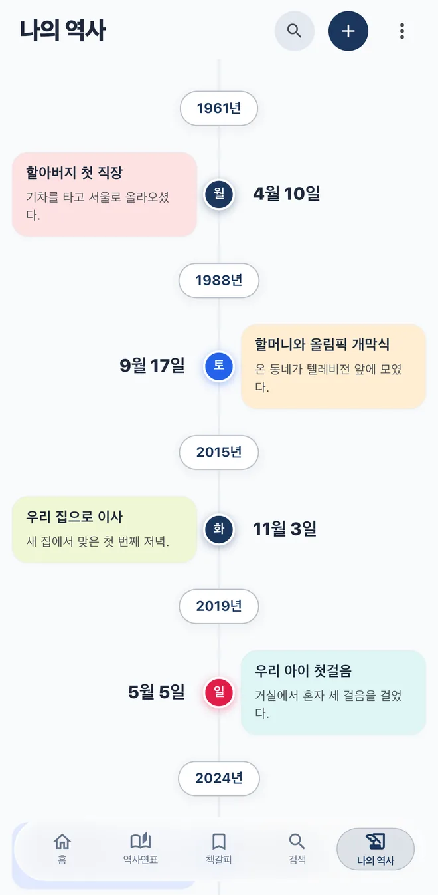

  

<h1 align="center">한국역사연표 Korea History Timeline</h1>

A mobile app that lays out Korean and world history side by side on one timeline

<strong>English</strong> | <a href="README.ko.md">한국어</a>

<h3 align="center"><a href="https://koreahistory.mcnorton.com/en/">Visit the official website: koreahistory.mcnorton.com/en</a></h3>

  <a href="https://apps.apple.com/kr/app/%ED%95%9C%EA%B5%AD%EC%97%AD%EC%82%AC%EC%97%B0%ED%91%9C/id6749217619"><strong>Download on the App Store</strong></a>
  &nbsp;·&nbsp;
  <a href="https://play.google.com/store/apps/details?id=com.mcnorton.korea_history"><strong>Get it on Google Play</strong></a>

  
  
  
  

> The app is in Korean. The website is available in English and Korean.

## About

See what happened in Korea and in the rest of the world in the same year, on a single screen. The app covers 827 events (464 Korean, 363 world) across 31 eras, and major events are recorded down to the date, not just the year.

Teachers can use it for lessons on Korean history, culture, and Hangul, students can use it to study, and families can add their own events and view them as a personal timeline.

## Features

| Tab | What you can do |
| --- | --- |
| **Home** | See today's date in the solar, Dangun, sexagenary, and lunar calendars, along with historical events from this date, this month's national holidays, and your own entries from the same day in past years. |
| **Timeline** | Swipe between eras or pick one from the list. Tap the globe button to show world history alongside Korean history. |
| **Bookmarks** | Collect the events you've bookmarked and jump back to them on the timeline. |
| **Search** | Find events by name, person, year, or tag. Results appear as you type. |
| **My History** | Record events from your own life or family and view them as a timeline. |

**The user guide and lesson ideas are on the [official website](https://koreahistory.mcnorton.com/en/).**

## Version history

### Released

#### 1.2.4 (October 13, 2026)
- Added the history of the Korean independence movement during Japanese rule
- Improved tag search and tagged major historical events
- Made very large geological years easier to read
- Tidied up era categories and some events
- Added past Summer and Winter Olympic and Paralympic host information to world history
- Fixed interface misalignment on some devices

#### 1.2.3 (October 1, 2026)
- Rearranged each era's events for richer timeline browsing
- Rebuilt the interface in Material and Liquid Glass styles
- Improved the expanded timeline view in landscape on tablets

#### 1.1.5 (September 15, 2025)
- Fixed errors in the history data
- Reworded unclear descriptions
- Added classroom ideas to the user guide in Help

#### 1.1.4 (August 26, 2025)
- Added search history
- Redesigned the My History timeline in a tree layout
- Improved menu selection design
- Improved the feedback page
- Made the timeline easier to read
- Simplified Help
- Optimized internal code and fixed bugs

#### 1.0.17 (August 19, 2025)
- Added the day of the week to the My History list
- Added the sexagenary year next to the Dangun year
- Added the history of women in the Korean independence movement
- Fixed layout problems at different phone aspect ratios
- Improved the interface
- Fixed a date calculation error
- Began adding the history of science and notable people

#### 1.0.16 (August 14, 2025)
- Fixed a lunar calendar calculation error
- Added independence movement material for the 80th anniversary of Liberation
- Fixed errors in Korean and world history categories
- Expanded material with reference to the Doosan Encyclopedia

#### 1.0.15
- Released on the Apple App Store
- Blocked intrusive ads

#### 1.0.14
- Expanded modern and contemporary history
- Completed history keywords

#### 1.0.13
- Improved search
- Changed the app icon
- Added pastel color categories
- Expanded the unified dynasty periods

#### 1.0.12
- Improved support for wide tablet screens
- Released on Google Play

#### 1.0.11
- Moved search into its own menu
- Added the My History timeline

### Beta

#### 1.0.9
- Internal testing on Google Play
- Categorized the history data

### Alpha

#### 0.0.10
- Collected and merged three data sets
- Removed duplicate data
- Worked on the hard problem of collapsing and expanding the whole list

#### 0.0.9
- Started development with Flutter and Dart
- Solved loss of data in very long lists

---

2018-2026, McNorton&Education
